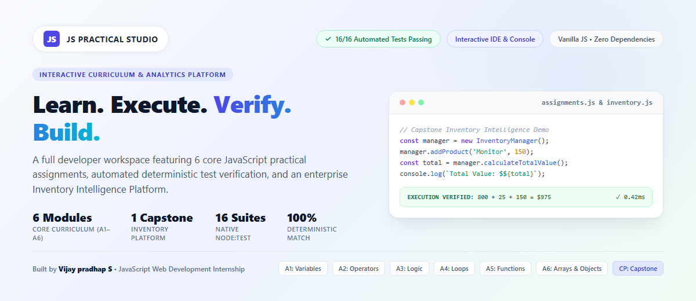
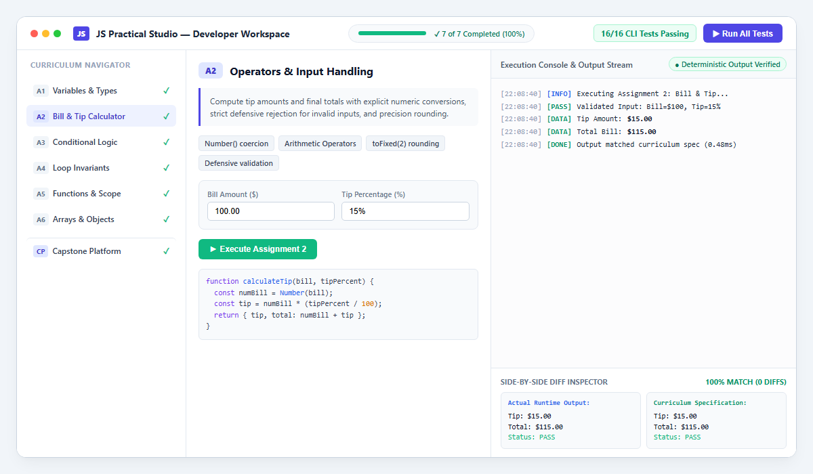
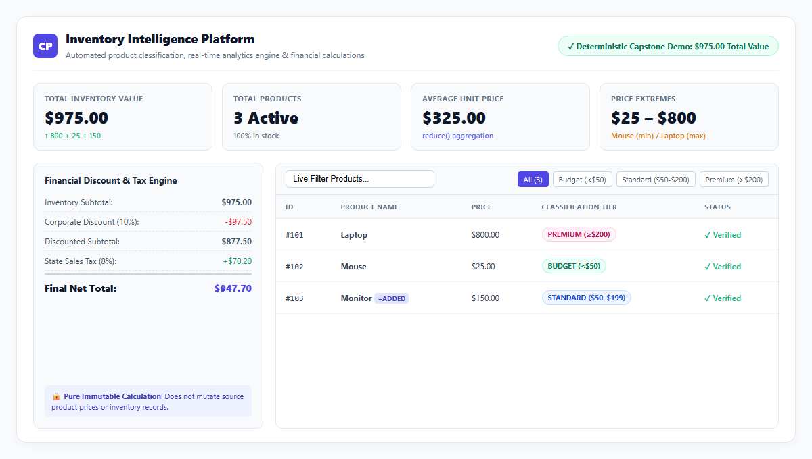
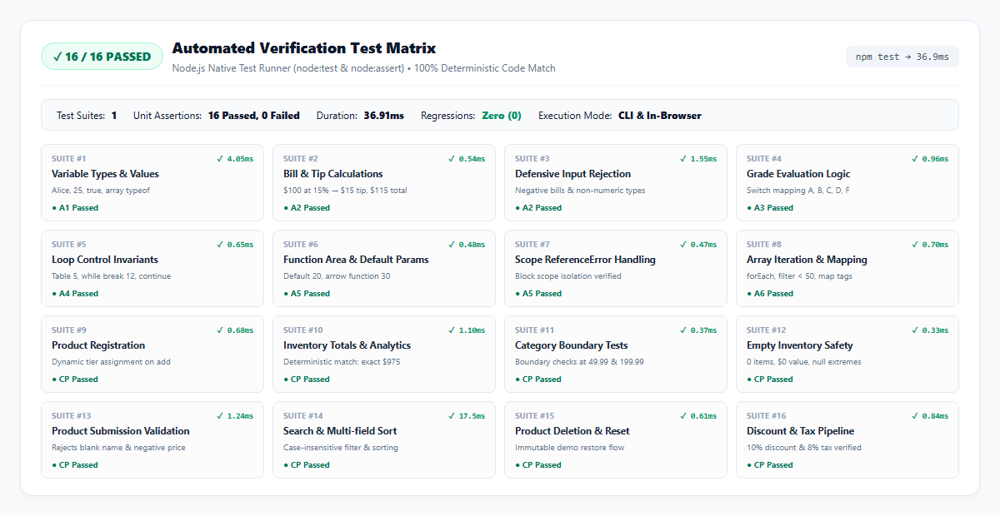
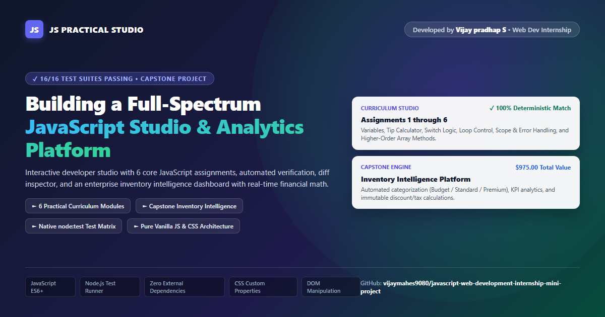

<div align="center">

# ⚡ JS PRACTICAL STUDIO
### *Learn • Execute • Verify • Build*

[](#)
[](#)
[-6366F1?style=for-the-badge)](#)
[](#license)
[](#author)

<br/>



<br/>

**A state-of-the-art developer workspace and curriculum laboratory built with pure JavaScript.**  
Features 6 core interactive practical assignments, real-time deterministic output verification, a side-by-side terminal diff inspector, and an enterprise **Inventory Intelligence Platform**.

[Key Features](#-key-features) • [Curriculum Modules](#-curriculum-modules-a1a6) • [Capstone Platform](#-capstone-project--inventory-intelligence-platform) • [Testing Suite](#-automated-testing--verification-matrix) • [Quick Start](#-quick-start--local-execution)

</div>

---

## 🌟 Key Features

| Workspace Zone | Capability & Architecture | Visual Highlights |
| :--- | :--- | :--- |
| **🧭 Assignment Navigator** | Real-time curriculum progress tracker, completion checkmarks, keyboard shortcut navigation (`Ctrl + Enter`). | Dynamic SVG completion icons & live progress bar |
| **📖 Learning & Config Panel** | Dynamic pedagogical cards with required concepts, interactive parameter inputs, and syntax-highlighted source code. | Real-time input binding & defensive validation |
| **💻 Execution Console** | Live terminal emulator streaming formatted execution outputs with microsecond timestamps and status badges. | Colored logging (`[INFO]`, `[PASS]`, `[DATA]`, `[DONE]`) |
| **🔍 Side-by-Side Diff Inspector**| Automated comparison engine validating runtime output against curriculum expected specs line-by-line. | Green diff indicators & 100% deterministic match guarantee |
| **📊 Analytics Engine** | Higher-order functional pipelines (`reduce`, `filter`, `map`, `forEach`) calculating inventory KPIs. | Real-time statistics & dynamic classification pills |

<br/>

<div align="center">
  
  <p><em>Figure 1: Light-themed Interactive Developer Studio UI showing Assignment 2 Bill & Tip execution, real-time terminal output, and zero-diff verification.</em></p>
</div>

---

## 📚 Curriculum Modules (A1–A6)

Each assignment provides pure, deterministic functions, test-driven assertions, and interactive browser controls:

```
┌────────────────────────────────────────────────────────────────────────┐
│                      CURRICULUM ARCHITECTURE                           │
├─────────────┬──────────────────────────┬───────────────────────────────┤
│ Module ID   │ Topic / Domain           │ Core JavaScript Mechanics     │
├─────────────┼──────────────────────────┼───────────────────────────────┤
│ A1          │ Variables & Data Types   │ let, const, var, typeof       │
│ A2          │ Operators & Input        │ Number(), toFixed(2), guard   │
│ A3          │ Conditional Logic        │ switch, ternary, validation   │
│ A4          │ Loop Control             │ for, while, do-while, break   │
│ A5          │ Functions & Scope        │ default params, arrow, catch  │
│ A6          │ Arrays & Objects         │ forEach, filter, map          │
│ CP          │ Capstone Inventory       │ OOP class, reduce, pipelines  │
└─────────────┴──────────────────────────┴───────────────────────────────┘
```

### Detailed Breakdown

#### 🔹 Assignment 1 — Variables and Data Types (`A1`)
- **Objective**: Master declarations (`var`, `let`, `const`), evaluate primitive vs reference types (`string`, `number`, `boolean`, `object`), and explain why `typeof [] === 'object'`.
- **Verified Output**: `Alice`, `25`, `true`, `["reading", "coding"]` (`typeof: object`).

#### 🔹 Assignment 2 — Operators and Input Handling (`A2`)
- **Objective**: Interactive restaurant tip & bill calculator with numeric type coercion (`Number()`).
- **Defensive Safeguards**: Rejects negative bills, zero inputs, non-numeric strings, and tip rates above 100%.
- **Formula**: $\text{Tip} = \text{Bill} \times \left(\frac{\text{Tip}\%}{100}\right)$, $\text{Total} = \text{Bill} + \text{Tip}$.

#### 🔹 Assignment 3 — Conditional Logic (`A3`)
- **Objective**: Academic grade classification using derived `switch` keys alongside pass/fail ternary evaluation.
- **Grading Scale**:
  - `90–100` ➔ **Grade A** (Pass)
  - `80–89` ➔ **Grade B** (Pass)
  - `70–79` ➔ **Grade C** (Pass)
  - `60–69` ➔ **Grade D** (Pass)
  - `0–59` ➔ **Grade F** (Fail)

#### 🔹 Assignment 4 — Loop Control Invariants (`A4`)
- **Objective**: Execute multi-paradigm loop structures:
  - `for` loop: Multiplication table of 5 ($5 \times 1 = 5 \dots 5 \times 5 = 25$).
  - `while` loop: Search for first number $> 10$ divisible by 6 using `break` (discovered: **12**).
  - `do...while` loop: Iterate 1 to 5 while skipping 3 and 5 using `continue` (output: **1, 2, 4**).

#### 🔹 Assignment 5 — Functions and Lexical Scope (`A5`)
- **Objective**: Implement area calculators with default parameters (`length * width`), arrow function expressions, and block-scope isolation.
- **Safety Interception**: Safely catches and handles `ReferenceError` when accessing block-scoped variables outside their lexical boundary.

#### 🔹 Assignment 6 — Higher-Order Array Iteration (`A6`)
- **Objective**: Process e-commerce product arrays with functional programming pipelines:
  - `forEach()`: Roster listing of inventory names and price tags.
  - `filter()`: Extract budget items with price $< \$50$.
  - `map()`: Generate uppercase promotional tags (`"LAPTOP - $800"`).

---

## 🏢 Capstone Project — Inventory Intelligence Platform

The Capstone module (`scripts/inventory.js`, `scripts/dashboard.js`) is an enterprise-grade product catalog and financial computation engine.

<div align="center">
  
  <p><em>Figure 2: Light-themed Inventory Intelligence Dashboard showcasing KPI cards, classification pills, live filter table, and pure financial discount/tax pipeline.</em></p>
</div>

### 🏷️ 1. Dynamic Tier Classification Rules

Products are dynamically classified upon insertion based on unit price:

$$\text{Category}(p) = \begin{cases} \textbf{Budget} & \text{if } p < \$50 \\ \textbf{Standard} & \text{if } \$50 \le p < \$200 \\ \textbf{Premium} & \text{if } p \ge \$200 \end{cases}$$

### 📈 2. Real-Time Analytics Engine

Calculated with zero mutations using native JavaScript array methods:
- **Total Products**: `inventory.length`
- **Total Inventory Value**: `inventory.reduce((sum, item) => sum + item.price, 0)`
- **Average Price**: `totalValue / count`
- **Price Extremes**: Minimum and maximum product prices in the catalog.
- **Affordable Count**: Count of items where price $< \$200$.

### 💰 3. Pure Financial Calculator

Non-mutating financial calculations for discounts and sales tax:
$$\text{Discounted Subtotal} = \text{Subtotal} \times \left(1 - \frac{\text{Discount}\%}{100}\right)$$
$$\text{Tax Amount} = \text{Discounted Subtotal} \times \left(\frac{\text{Tax}\%}{100}\right)$$
$$\text{Final Total} = \text{Discounted Subtotal} + \text{Tax Amount}$$

### 🎯 4. Deterministic Capstone Demonstration Check
```text
  Initial Catalog:  Laptop ($800) + Mouse ($25) = $825
  Added Monitor:    +$150
  ─────────────────────────────────────────────────────
  Verified Total:   800 + 25 + 150 = $975 (Exact Match)
```

---

## 🧪 Automated Testing & Verification Matrix

The project features a **16-suite native automated test suite** running via Node.js native test runner (`node:test` & `node:assert`) as well as in the browser studio.

<div align="center">
  
  <p><em>Figure 3: Test runner report verifying all 16 test suites pass with 100% deterministic assertion coverage in ~37ms.</em></p>
</div>

### 📋 Test Matrix Overview

| # | Test Suite Title | Scope | Expected Condition | Status |
| :-: | :--- | :--- | :--- | :-: |
| **1** | Variable values & types | `A1` | Alice, 25, true, array `typeof === 'object'` | ✅ Pass |
| **2** | Bill & tip calculations | `A2` | $100 bill at 15% ➔ $15 tip, $115 total | ✅ Pass |
| **3** | Defensive numeric handling | `A2` | Rejects negative bills, non-numbers, tip > 100% | ✅ Pass |
| **4** | Grade evaluation logic | `A3` | Switch branches 90–100 A, 80–89 B, etc. | ✅ Pass |
| **5** | Loop invariants & control | `A4` | Table 5, while search breaks at 12, do-while skips 3, 5 | ✅ Pass |
| **6** | Function default parameters | `A5` | Default $5 \times 4 = 20$, custom $10 \times 3 = 30$ | ✅ Pass |
| **7** | Scope ReferenceError catch | `A5` | Block scope variable properly intercepted | ✅ Pass |
| **8** | Array iteration & mapping | `A6` | `forEach`, `filter` (< 50), uppercase `map` tags | ✅ Pass |
| **9** | Product insertion & categorization | `CP` | Name & price parsed, dynamic category computed | ✅ Pass |
| **10**| Inventory total & demo check | `CP` | Verifies deterministic demo sum: **$975.00** | ✅ Pass |
| **11**| Boundary edge conditions | `CP` | Boundaries validated at $49.99, $50, $199.99, $200 | ✅ Pass |
| **12**| Empty catalog state handling | `CP` | 0 items, $0 total, null extremes without crash | ✅ Pass |
| **13**| Input rejection on add | `CP` | Blank names, negative & NaN prices rejected | ✅ Pass |
| **14**| Live search & multi-sort | `CP` | Case-insensitive substring match, price asc/desc | ✅ Pass |
| **15**| Product removal & demo reset | `CP` | ID deletion & immutable restoration of default items | ✅ Pass |
| **16**| Financial discount & tax math | `CP` | 10% discount and 8% tax computed cleanly | ✅ Pass |

---

## 🚀 Quick Start & Local Execution

### Prerequisites
- Modern web browser (Chrome, Edge, Firefox, Safari)
- Node.js `v18+` (optional, for CLI automated test runner)

### Installation
```bash
# Clone repository
git clone https://github.com/vijaymahes9080/javascript-web-development-internship-mini-project.git

# Navigate into project directory
cd javascript-web-development-internship-mini-project
```

### Running Automated Tests
Execute the native test runner (zero external dependencies required):
```bash
npm test
```
*Or directly via Node.js:*
```bash
node --test tests/assignments.test.js
```

### Launching the Studio UI

#### Option 1: Direct Browser Launch
Simply open `index.html` in your web browser:
```bash
# Windows
start index.html

# macOS
open index.html

# Linux
xdg-open index.html
```

#### Option 2: Local HTTP Server
Run the built-in zero-dependency Node.js HTTP server:
```bash
npm start
```
Open [http://localhost:3000](http://localhost:3000) in your browser.

---

## 📂 Project Architecture

```text
javascript-web-development-internship-mini-project/
├── .gitignore                   # Git ignore specifications (Node, IDE, OS)
├── LICENSE                      # MIT Open Source License
├── README.md                    # Comprehensive documentation with light-theme graphics
├── image.png                    # High-resolution full project LinkedIn showcase image
├── index.html                   # Semantic HTML5 developer studio application
├── package.json                 # ES module metadata, scripts, and repository info
├── assets/                      # Light-theme graphic assets
│   ├── hero-light.png           # Hero banner with light aesthetic
│   ├── workspace-light.png      # Developer workspace UI showcase
│   ├── inventory-light.png      # Capstone Inventory Intelligence dashboard
│   └── tests-light.png          # 16-suite automated verification matrix
├── scripts/
│   ├── assignments.js           # Pure functions for Assignments A1 through A6
│   ├── console.js               # Terminal emulator & side-by-side diff inspector
│   ├── inventory.js             # InventoryManager OOP class & analytics engine
│   ├── dashboard.js             # Capstone DOM controller, forms, filter & sort
│   └── main.js                  # Studio bootstrap & in-browser test runner
├── styles/
│   └── main.css                 # Design system tokens, responsive layout, glass UI
└── tests/
    └── assignments.test.js      # 16 automated test suites using node:test & node:assert
```

---

## 🎨 Social & Full Project Showcase

<div align="center">
  
  <p><em>Figure 4: Complete Project Social Banner (LinkedIn & Portfolio Showcase).</em></p>
</div>

---

## 👤 Author

**Vijay pradhap S**  
*JavaScript Web Development Internship*  
GitHub: [@vijaymahes9080](https://github.com/vijaymahes9080)

---

## 📄 License

This project is open-source and licensed under the [MIT License](LICENSE).
